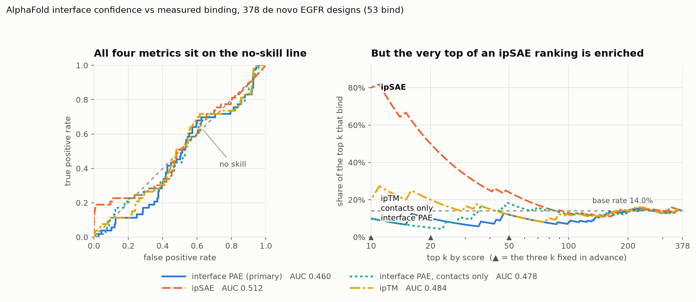

# binder-bench

**Does AlphaFold's interface confidence predict whether a designed protein binder
actually binds?**

In this dataset, no.

Designers routinely filter de novo binder libraries by interface confidence
metrics, and BindCraft reports that interface PAE is a powerful binary predictor
of binding. This benchmark tests that claim against experimental binding data,
with the analysis pre-registered before any outcome was examined. All four
metrics sit at chance.

<picture>
  <source media="(prefers-color-scheme: dark)" srcset="results/figures/headline_dark.png">
  
</picture>

<sub>Regenerate with `uv run --group figures python scripts/make_figures.py`. Both
panels are drawn from the same table the statistics read, and the ROC helper is
tested against the reported AUC so the picture cannot disagree with the
numbers.</sub>

---

## The result

The population is the 378 expressed designs from Adaptyv Bio's public EGFR binder
competition, Round 2. Fifty-three of them bind, a base rate of 14.0%. Each design
was folded fresh here with AlphaFold2-multimer v3, five models per design, and
scored on four interface confidence metrics.

**Claim A, binary discrimination: does the score separate binders from
non-binders?** No. Every 95% interval covers 0.5, and nothing survives
Benjamini-Hochberg correction across the metric family.

**Claim B, affinity ranking: does the score track dissociation constant among the
designs that do bind?** No. Every 95% interval covers 0.

| metric | role | AUC | 95% CI | Spearman vs KD (n=44) | 95% CI |
|---|---|---|---|---|---|
| `pae_interface_mean` | primary | 0.460 | [0.384, 0.541] | -0.158 | [-0.449, 0.161] |
| `pae_interface_contacts_mean` | secondary | 0.478 | [0.394, 0.565] | -0.080 | [-0.383, 0.247] |
| `iptm` | secondary | 0.484 | [0.402, 0.568] | +0.110 | [-0.226, 0.409] |
| `ipsae` | secondary | 0.512 | [0.424, 0.604] | -0.012 | [-0.340, 0.306] |

Decile calibration curves are flat and non-monotone for all four, so these scores
behave neither as rankers nor as thresholds across their range.

**This is a powered null, not an underpowered shrug.** The achieved Hanley-McNeil
standard error is 0.042, against a forecast of 0.040 to 0.044 written into the
spec before the data were touched. An effect large enough to be useful as a
filter would have been detected.

The result therefore **contradicts** BindCraft's claim that interface confidence
is a strong binary predictor of binding, and **replicates** its claim that it does
not track affinity. Both were originally asserted from box plots without interval
estimates. Both now have intervals.

## The one real exception

ipSAE carries information in its extreme tail only, which a global rank statistic
like AUC averages away. The values of k were fixed in advance.

| top k by ipSAE | binders | rate | hypergeometric p | enrichment |
|---|---|---|---|---|
| 10 | 8 | 80% | 3.3e-6 | 5.7x |
| 20 | 10 | 50% | 8.0e-5 | 3.6x |
| 50 | 12 | 24% | 0.03 | 1.7x |

Only one design ties the tenth-ranked value, so the cut is not an artifact of
where the line fell. The two metrics the field actually thresholds on show no such
tail: `pae_interface_mean` puts 1 binder in its top 10 and `iptm` puts 2, both at
or below the 14% base rate.

The practical reading is narrow but genuine: **do not use these scores to rank a
library, but the very top of an ipSAE ranking is worth ordering.** That ipSAE alone
shows this, while ipTM does not, is evidence for correcting ipTM's chain-size
dependence (Dunbrack lab, bioRxiv 2025.02.10.637595) rather than evidence about
confidence metrics in general.

## What the positive controls show

Two known EGFR binders were folded through the identical pipeline. Both reproduce
their crystallographic binding mode, at 6.6x to 11.1x epitope enrichment over
chance against PDB 1IVO and 1YY9, which is what validates the pipeline.

Both nevertheless score as non-binders.

| control | KD | `pae_interface_mean` | `ipsae` | beats |
|---|---|---|---|---|
| Human EGF | 7.6 nM | 21.92 | 0.0123 | 55% / 52% of designs |
| Cetuximab scFv | 6.6 nM | 26.58 | 0.0000 | 7% / 0% of designs |

Cetuximab, a licensed drug, scores below **every one** of the 378 designs on
ipSAE. A confidence filter applied to these two molecules would have discarded
both.

---

## Method

**Data.** Adaptyv Bio ran a public competition to design binders against EGFR and
published the experimental results. 1,131 designs were submitted, 400 were
assayed, 378 expressed. Binding is defined in `data/binds_definition.txt`; nine of
the 53 binders have KD pinned at the 1e-5 M assay ceiling and are handled as
censored.

**Folding.** 380 sequences (378 designs plus 2 positive controls), five
AlphaFold2-multimer v3 models each via ColabFold, on L40S GPUs on Modal. 1,900
predictions, zero failures, zero dropped. Total measured spend across the whole
project to date: **$47.56**.

**Metrics.** Interface PAE averaged over all binder-target residue pairs, interface
PAE restricted to contacting pairs, ipTM, and ipSAE (Dunbrack lab implementation,
vendored under `vendor/` with its MIT license). Plus an independent geometry pass
used for epitope recovery on the controls.

**Why AlphaFold2-multimer and not AlphaFold3.** AF2-multimer is the model whose
metrics gated which designs Adaptyv chose to assay, and BindCraft still runs on
AF2, so it is the model the claim under test is actually about. AlphaFold3 and the
Boltz line are untested here and are the obvious follow-up.

## How the analysis was protected from itself

A benchmark that is free to choose its own statistics after seeing the data can
produce whatever result its author prefers. The protections here are structural,
and the git history is the evidence:

- `ANALYSIS_PLAN.md` was committed **before any statistic was computed**. The
  commit timestamp is the point of it.
- Step 3 ran **once**. The join matched the pre-registration exactly: 378 designs,
  53 binders, 14.0% base rate.
- The k values for precision-at-k, the primary metric, the binding threshold, the
  denominator, and the censoring rule were all fixed in advance.
- The design selection arms are never pooled into a headline statistic. Adaptyv's
  tested 400 were not a random sample of the 1,131 submissions: 100 were chosen by
  a three-metric rank average and 300 were hand-curated for diversity, so pooling
  them would bake that selection into the answer.
- No confidence score computed by anyone else is ever used as the prediction.
  Every structure was folded here.

## Caveats

The full list is in [`results/README.md`](results/README.md). The three that most
affect how this should be read:

1. **Absolute values here are not comparable to published thresholds.** Interface
   PAE averages over every binder-target residue pair, and the EGFR ectodomain is
   621 residues, which inflates it. No literature threshold applies to these
   numbers. Every statistic in this project is therefore rank based.
2. **Both controls are in AlphaFold's training data.** They validate the pipeline
   and never the metric. Their low scores are more striking for it, not less.
3. **65% of designs have binder pLDDT below 50.** AlphaFold does not believe two
   thirds of these designs fold at all, which is context for what the interface
   scores are describing.

---

## Reproduce

```bash
uv sync
uv run pytest        # 371 tests, no GPU, no network, about 40 seconds
uv run python scripts/run_step3.py --metrics results/tables/per_design_metrics.csv
uv run --group figures python scripts/make_figures.py   # redraws the figure above
```

The second command recomputes **every number in the tables above** from
`results/tables/per_design_metrics.csv`, which holds one row per folded design:
the five-model mean for each of the four metrics, the spread, and the model
count. No GPU, no Modal account, no network. It overwrites the committed tables
in place, so `git diff` after running it is the check: an empty diff means the
published result is exactly what this code produces from this data.

That table was exported from the fold records with
`scripts/export_per_design_metrics.py`. The records themselves, with the
structures and the raw PAE matrices, are gigabytes and live on a Modal Volume.
Re-folding from sequences needs a Modal account and roughly $38 of GPU time:

```bash
uv run modal run modal_app/fold.py          # 380 designs, five models each
uv run python scripts/run_step3.py --folds <dir>
```

Both paths apply the same population, the same refusals and the same estimator,
and a test asserts they agree.

## Layout

```
SPEC.md              the experiment spec, binding on the implementation
ANALYSIS_PLAN.md     pre-registered, committed before any statistic was computed
PRIOR_ART.md         what BindCraft, EvoBind2 and UnibindMD claim, and on what evidence
DECISIONS.md         running decision log, dated, one line each
results/README.md    full numbers and all caveats
results/tables/      per-design metrics (the analysis input), plus AUC, CI,
                     Spearman, decile calibration and the summary JSON
results/figures/     the headline figure, light and dark
src/binder_bench/    pipeline: folding config, MSA, parsing, metrics, geometry, statistics
modal_app/           Modal app definitions
tests/               unit tests
data/                designs and submissions tables, target sequence, binding definition
```

Two working files addressed to the coding agent used on this project, `CLAUDE.md`
and a session handoff file, are not included here; a few `DECISIONS.md` entries
refer to them. `SPEC.md` and `ANALYSIS_PLAN.md` are the documents that govern the
science, and both are here.

## Status

Steps 0 through 3 are complete and the experiment has a result. Remaining work:
the truncation analysis for the non-random assay selection
(`ANALYSIS_PLAN.md` section 2a), an unpaired-MSA verification fold, and a
molecular dynamics triage step that has not been started.

## Attribution

Nina Phatak, UCLA. This is an independent first-author project, conducted while in
Giulia Palermo's lab, and is not a Palermo lab output.

`vendor/ipsae.py` is the Dunbrack lab's ipSAE implementation, MIT licensed, with
its license retained at `vendor/IPSAE_LICENSE`.

Experimental binding data is from Adaptyv Bio's public EGFR binder design
competition and remains theirs under their own terms. The MIT license below
covers the code in this repository, not that data.

## License

MIT. See [`LICENSE`](LICENSE).
